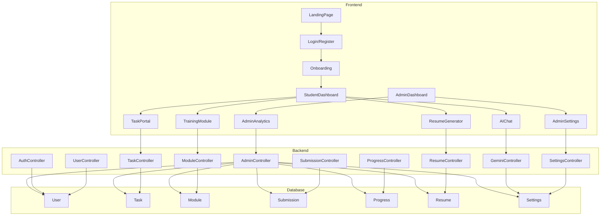
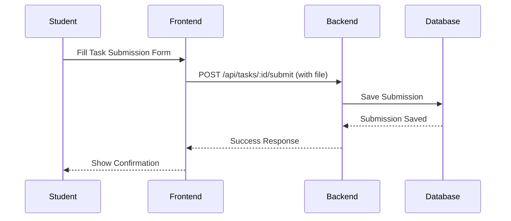
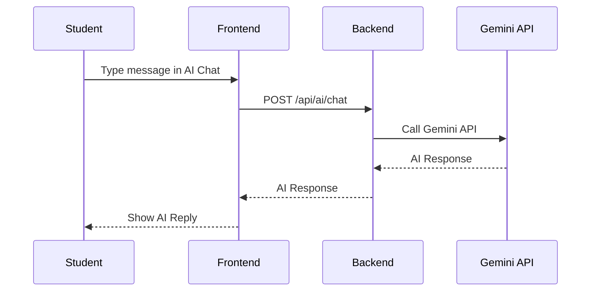
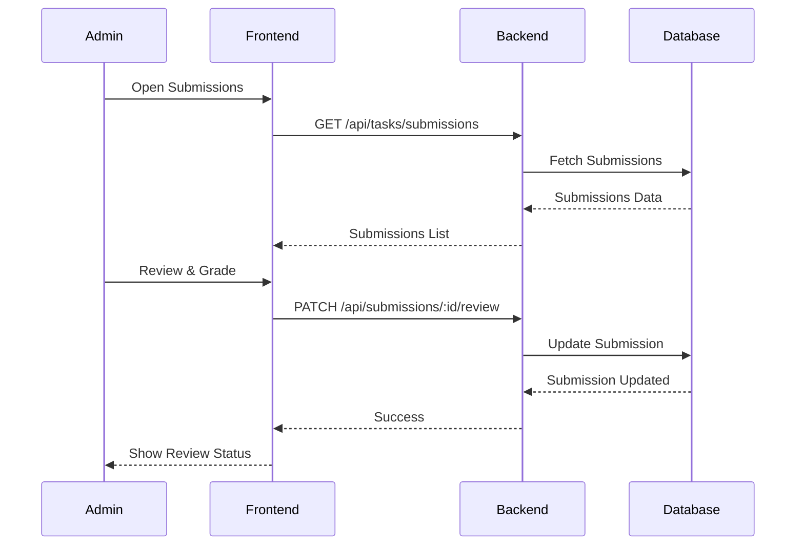

# Syncner Platform: High-Level & Low-Level Design

---

## High-Level Design (HLD)

### 1. System Overview
Syncner is a full-stack educational platform for students and admins, supporting:
- Student onboarding, training modules, task management, submissions, resume generation, and AI mentor.
- Admin dashboards for analytics, user/module/task management, and platform settings.

### 2. Architecture
- **Frontend:** React + TypeScript (Vite, Redux, Tailwind)
- **Backend:** Node.js + Express + MongoDB (Mongoose)
- **AI Integration:** Google Gemini API (via backend)
- **File Uploads:** Multer (backend)
- **Authentication:** JWT-based, role-based access control

### 3. Key Modules
- **Frontend:**
  - Auth, Onboarding, Dashboard, Training, Tasks, Submissions, Resume, AI Chat, Admin (Analytics, Settings, Management)
- **Backend:**
  - Auth, User, Task, Module, Submission, Progress, Resume, Settings, AI (Gemini)
- **Database:**
  - Users, Tasks, Modules, Submissions, Progress, Resume, Settings

### 4. User Roles & Flows
- **Student:** Register → Onboarding → Dashboard → Training/Tasks → Submit → View Feedback/Resume → AI Mentor
- **Admin:** Login → Dashboard → Analytics → Manage Users/Modules/Tasks → Review Submissions → Settings

### 5. Component/Block Diagram

---

## Low-Level Design (LLD)

### 1. Key Data Models
- **User:** id, name, email, password, role, college, careerTrack, profileComplete, etc.
- **Task:** id, title, description, category, difficulty, points, careerTrack, assignedTo, dueDate, etc.
- **Module:** id, title, description, difficulty, careerTrack, lessons, etc.
- **Submission:** id, task, student, description, files, status, score, feedback, etc.
- **Progress:** user, careerTrack, moduleProgress, taskProgress, achievements, etc.
- **Resume:** user, personalInfo, summary, education, skills, projects, certifications, experience, etc.
- **Settings:** general, notifications, security, integrations

### 2. Key API Endpoints
- `/api/auth/register`, `/api/auth/login`, `/api/auth/profile`
- `/api/tasks`, `/api/tasks/:id/submit`, `/api/tasks/upcoming`, `/api/tasks/all`
- `/api/training`, `/api/training/:id`
- `/api/submissions/my`, `/api/submissions/:id/review`
- `/api/admin/analytics`, `/api/admin/users`
- `/api/ai/chat`, `/api/ai/feedback`, `/api/ai/resume`
- `/api/admin/settings`

### 3. Sequence Diagrams

#### Task Submission

#### AI Chat Mentor

#### Admin Reviews Submission

### 4. Security & Error Handling
- JWT authentication, role-based guards, input validation, error handler middleware, rate limiting, CORS, helmet.

---

# End of Document 