# Syncner Learning Management System - API Endpoints Summary

## Document Information
- **Version**: 1.0
- **Date**: January 2024
- **Author**: Development Team
- **Status**: Production Ready

## Complete API Endpoints Overview

```mermaid
graph TB
    subgraph "🔐 Authentication (8 endpoints)"
        A1[POST /api/auth/register]
        A2[POST /api/auth/login]
        A3[POST /api/auth/logout]
        A4[GET /api/auth/profile]
        A5[PUT /api/auth/profile]
        A6[POST /api/auth/forgot-password]
        A7[POST /api/auth/reset-password]
        A8[GET /api/auth/health]
    end
    
    subgraph "👤 User Management (4 endpoints)"
        U1[GET /api/users/profile]
        U2[PUT /api/users/profile]
        U3[GET /api/users/]
        U4[GET /api/users/health]
    end
    
    subgraph "🎓 Student (3 endpoints)"
        ST1[GET /api/student/portfolio/me]
        ST2[GET /api/student/portfolio/:studentId]
        ST3[GET /api/student/portfolio/public/:studentId]
    end
    
    subgraph "👨‍🏫 Staff (6 endpoints)"
        S1[GET /api/staff/students]
        S2[GET /api/staff/students/:id]
        S3[GET /api/staff/analytics]
        S4[GET /api/staff/leaderboard]
        S5[GET /api/staff/leaderboard/:careerTrack]
        S6[GET /api/staff/test/:id]
    end
    
    subgraph "⚙️ Admin (12 endpoints)"
        AD1[GET /api/admin/users]
        AD2[POST /api/admin/users]
        AD3[PUT /api/admin/users/:id]
        AD4[DELETE /api/admin/users/:id]
        AD5[POST /api/admin/users/:id/reset-password]
        AD6[GET /api/admin/analytics]
        AD7[GET /api/admin/level-progress]
        AD8[GET /api/admin/health]
        AD9[GET /api/admin/diagnostics]
        AD10[GET /api/admin/check-progress-orders]
        AD11[POST /api/admin/fix-progress-orders]
        AD12[POST /api/admin/cleanup-orphaned-progress]
    end
    
    subgraph "📚 Curriculum (18 endpoints)"
        C1[GET /api/curriculum]
        C2[POST /api/curriculum]
        C3[GET /api/curriculum/:id]
        C4[PUT /api/curriculum/:id]
        C5[DELETE /api/curriculum/:id]
        C6[PATCH /api/curriculum/:id/toggle]
        C7[GET /api/curriculum/stats]
        C8[POST /api/curriculum/invalidate-cache]
        C9[PUT /api/curriculum/bulk-order]
        C10[DELETE /api/curriculum/level]
        C11[PUT /api/curriculum/level/reorder]
        C12[GET /api/curriculum/type/:type/track/:careerTrack]
        C13[GET /api/curriculum/content/:type]
        C14[GET /api/curriculum/content/:type/track/:careerTrack]
        C15[POST /api/curriculum/content]
        C16[PUT /api/curriculum/content/:id]
        C17[DELETE /api/curriculum/content/:id]
        C18[GET /api/curriculum/health]
    end
    
    subgraph "📊 Progress (12 endpoints)"
        PR1[GET /api/progress/:careerTrack]
        PR2[GET /api/progress/levels-status]
        PR3[GET /api/progress/unlocked/:levelOrder]
        PR4[GET /api/progress/test-unlocked/:levelId]
        PR5[GET /api/progress/exercise-unlocked/:levelId]
        PR6[GET /api/progress/exercise-links/:levelId]
        PR7[GET /api/progress/level-sections/:levelId]
        PR8[POST /api/progress/complete]
        PR9[POST /api/progress/learn-progress]
        PR10[POST /api/progress/test-attempt]
        PR11[POST /api/progress/submit-exercise]
        PR12[PUT /api/progress/update-exercise]
    end
    
    subgraph "🏫 Training (3 endpoints)"
        T1[GET /api/training/levels]
        T2[GET /api/training/levels/:id]
        T3[GET /api/training/health]
    end
    
    subgraph "📅 Attendance (3 endpoints)"
        AT1[POST /api/attendance/mark]
        AT2[GET /api/attendance/:userId]
        AT3[GET /api/attendance/stats/:userId]
    end
    
    subgraph "🤖 AI (2 endpoints)"
        AI1[POST /api/ai/chat]
        AI2[GET /api/ai/health]
    end
    
    subgraph "⚙️ Settings (3 endpoints)"
        SET1[GET /api/admin/settings]
        SET2[PUT /api/admin/settings]
        SET3[GET /api/admin/settings/health]
    end
    
    subgraph "🎯 Track (3 endpoints)"
        TR1[GET /api/tracks]
        TR2[GET /api/tracks/:id]
        TR3[GET /api/tracks/health]
    end
    
    subgraph "🏥 Health (9 endpoints)"
        H1[GET /api/health]
        H2[GET /api/auth/health]
        H3[GET /api/users/health]
        H4[GET /api/tracks/health]
        H5[GET /api/training/health]
        H6[GET /api/admin/health]
        H7[GET /api/admin/settings/health]
        H8[GET /api/ai/health]
        H9[GET /api/curriculum/health]
    end
    
    subgraph "🌍 Public (1 endpoint)"
        PUB1[GET /api/student/portfolio/public/:studentId]
    end
    
    subgraph "📁 Upload (1 endpoint)"
        F1[POST /api/upload]
    end
    
    %% Styling
    style A1 fill:#e1f5fe
    style U1 fill:#e8f5e8
    style ST1 fill:#fff3e0
    style S1 fill:#f3e5f5
    style AD1 fill:#fce4ec
    style C1 fill:#fff8e1
    style PR1 fill:#e0f2f1
    style T1 fill:#f1f8e9
    style AT1 fill:#fce4ec
    style AI1 fill:#e8eaf6
    style SET1 fill:#fff3e0
    style TR1 fill:#e0f2f1
    style H1 fill:#f3e5f5
    style PUB1 fill:#e1f5fe
    style F1 fill:#fff8e1
```



## API Endpoints by Category

### 🔐 Authentication (8 endpoints)
- **POST** `/api/auth/register` - User registration
- **POST** `/api/auth/login` - User login
- **POST** `/api/auth/logout` - User logout
- **GET** `/api/auth/profile` - Get user profile
- **PUT** `/api/auth/profile` - Update user profile
- **POST** `/api/auth/forgot-password` - Request password reset
- **POST** `/api/auth/reset-password` - Reset password
- **GET** `/api/auth/health` - Auth service health check

### 👤 User Management (4 endpoints)
- **GET** `/api/users/profile` - Get user profile
- **PUT** `/api/users/profile` - Update user profile
- **GET** `/api/users/` - Get all users (admin)
- **GET** `/api/users/health` - Users service health check

### 🎓 Student (3 endpoints)
- **GET** `/api/student/portfolio/me` - Get current student's portfolio
- **GET** `/api/student/portfolio/:studentId` - Get specific student's portfolio
- **GET** `/api/student/portfolio/public/:studentId` - Get public portfolio

### 👨‍🏫 Staff (6 endpoints)
- **GET** `/api/staff/students` - Get all students with filters
- **GET** `/api/staff/students/:id` - Get detailed student information
- **GET** `/api/staff/analytics` - Get staff analytics data
- **GET** `/api/staff/leaderboard` - Get overall leaderboard
- **GET** `/api/staff/leaderboard/:careerTrack` - Get track-specific leaderboard
- **GET** `/api/staff/test/:id` - Get test details

### ⚙️ Admin (12 endpoints)
- **GET** `/api/admin/users` - Get all users with management
- **POST** `/api/admin/users` - Create new user
- **PUT** `/api/admin/users/:id` - Update user
- **DELETE** `/api/admin/users/:id` - Delete user
- **POST** `/api/admin/users/:id/reset-password` - Reset user password
- **GET** `/api/admin/analytics` - Get admin analytics
- **GET** `/api/admin/level-progress` - Get level progress analytics
- **GET** `/api/admin/health` - Admin service health check
- **GET** `/api/admin/diagnostics` - System diagnostics
- **GET** `/api/admin/check-progress-orders` - Check progress consistency
- **POST** `/api/admin/fix-progress-orders` - Fix progress issues
- **POST** `/api/admin/cleanup-orphaned-progress` - Cleanup orphaned data

### 📚 Curriculum (18 endpoints)
- **GET** `/api/curriculum` - Get all curriculum items
- **POST** `/api/curriculum` - Create curriculum item
- **GET** `/api/curriculum/:id` - Get curriculum item by ID
- **PUT** `/api/curriculum/:id` - Update curriculum item
- **DELETE** `/api/curriculum/:id` - Delete curriculum item
- **PATCH** `/api/curriculum/:id/toggle` - Toggle curriculum status
- **GET** `/api/curriculum/stats` - Get curriculum statistics
- **POST** `/api/curriculum/invalidate-cache` - Invalidate cache
- **PUT** `/api/curriculum/bulk-order` - Update bulk order
- **DELETE** `/api/curriculum/level` - Delete level by track and order
- **PUT** `/api/curriculum/level/reorder` - Reorder levels
- **GET** `/api/curriculum/type/:type/track/:careerTrack` - Get by type and track
- **GET** `/api/curriculum/content/:type` - Get content by type
- **GET** `/api/curriculum/content/:type/track/:careerTrack` - Get content by type and track
- **POST** `/api/curriculum/content` - Create content item
- **PUT** `/api/curriculum/content/:id` - Update content item
- **DELETE** `/api/curriculum/content/:id` - Delete content item
- **GET** `/api/curriculum/health` - Curriculum service health check

### 📊 Progress (12 endpoints)
- **GET** `/api/progress/:careerTrack` - Get user progress for track
- **GET** `/api/progress/levels-status` - Get levels status
- **GET** `/api/progress/unlocked/:levelOrder` - Check if level is unlocked
- **GET** `/api/progress/test-unlocked/:levelId` - Check if test is unlocked
- **GET** `/api/progress/exercise-unlocked/:levelId` - Check if exercise is unlocked
- **GET** `/api/progress/exercise-links/:levelId` - Get exercise links
- **GET** `/api/progress/level-sections/:levelId` - Get level sections status
- **POST** `/api/progress/complete` - Mark level as completed
- **POST** `/api/progress/learn-progress` - Update learning progress
- **POST** `/api/progress/test-attempt` - Submit test attempt
- **POST** `/api/progress/submit-exercise` - Submit exercise
- **PUT** `/api/progress/update-exercise` - Update exercise submission

### 🏫 Training (3 endpoints)
- **GET** `/api/training/levels` - Get all training levels
- **GET** `/api/training/levels/:id` - Get specific training level
- **GET** `/api/training/health` - Training service health check

### 📅 Attendance (3 endpoints)
- **POST** `/api/attendance/mark` - Mark attendance
- **GET** `/api/attendance/:userId` - Get user attendance
- **GET** `/api/attendance/stats/:userId` - Get attendance statistics

### 🤖 AI (2 endpoints)
- **POST** `/api/ai/chat` - Chat with AI
- **GET** `/api/ai/health` - AI service health check

### ⚙️ Settings (3 endpoints)
- **GET** `/api/admin/settings` - Get platform settings
- **PUT** `/api/admin/settings` - Update platform settings
- **GET** `/api/admin/settings/health` - Settings service health check

### 🎯 Track (3 endpoints)
- **GET** `/api/tracks` - Get all career tracks
- **GET** `/api/tracks/:id` - Get specific career track
- **GET** `/api/tracks/health` - Tracks service health check

### 🏥 Health (9 endpoints)
- **GET** `/api/health` - Main health check
- **GET** `/api/auth/health` - Auth service health
- **GET** `/api/users/health` - Users service health
- **GET** `/api/tracks/health` - Tracks service health
- **GET** `/api/training/health` - Training service health
- **GET** `/api/admin/health` - Admin service health
- **GET** `/api/admin/settings/health` - Settings service health
- **GET** `/api/ai/health` - AI service health
- **GET** `/api/curriculum/health` - Curriculum service health

### 🌍 Public (1 endpoint)
- **GET** `/api/student/portfolio/public/:studentId` - Get public portfolio

### 📁 Upload (1 endpoint)
- **POST** `/api/upload` - Upload file

## Summary Statistics

| Category | Endpoints | Description |
|----------|-----------|-------------|
| **Authentication** | 8 | User authentication and profile management |
| **User Management** | 4 | User profile operations |
| **Student** | 3 | Student portfolio access |
| **Staff** | 6 | Staff management and analytics |
| **Admin** | 12 | Administrative functions and diagnostics |
| **Curriculum** | 18 | Course content management |
| **Progress** | 12 | Learning progress tracking |
| **Training** | 3 | Training level management |
| **Attendance** | 3 | Attendance tracking |
| **AI** | 2 | AI chat functionality |
| **Settings** | 3 | Platform configuration |
| **Track** | 3 | Career track management |
| **Health** | 9 | System health monitoring |
| **Public** | 1 | Public portfolio access |
| **Upload** | 1 | File upload functionality |
| **TOTAL** | **87** | **Complete API endpoint count** |

## Authentication Requirements

### Public Endpoints (No Authentication)
- `GET /api/health`
- `GET /api/auth/health`
- `GET /api/users/health`
- `GET /api/tracks/health`
- `GET /api/training/health`
- `GET /api/admin/health`
- `GET /api/admin/settings/health`
- `GET /api/ai/health`
- `GET /api/curriculum/health`
- `GET /api/student/portfolio/public/:studentId`

### Protected Endpoints (Authentication Required)
- All other endpoints require JWT token in Authorization header
- Role-based access control for admin and staff endpoints

## Base URL
```
Production: https://syncner-test.onrender.com/api
Development: http://localhost:5000/api
```

---

**Document Version**: v1.0  
**Last Updated**: January 2024  
**Next Review**: January 2025
