# Syncner Learning Management System - Application Flow Diagram

## Document Information
- **Version**: 1.0
- **Date**: January 2024
- **Author**: Development Team
- **Status**: Production Ready

## Table of Contents
1. [Overall System Flow](#overall-system-flow)
2. [User Authentication Flow](#user-authentication-flow)
3. [Student Learning Flow](#student-learning-flow)
4. [Staff Management Flow](#staff-management-flow)
5. [Admin Management Flow](#admin-management-flow)
6. [Portfolio Generation Flow](#portfolio-generation-flow)
7. [API Request Flow](#api-request-flow)
8. [Data Flow Architecture](#data-flow-architecture)

## Overall System Flow

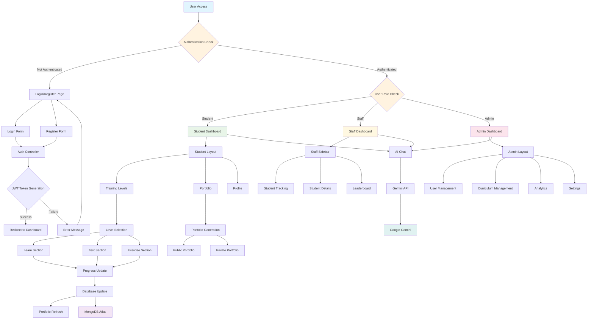

## User Authentication Flow

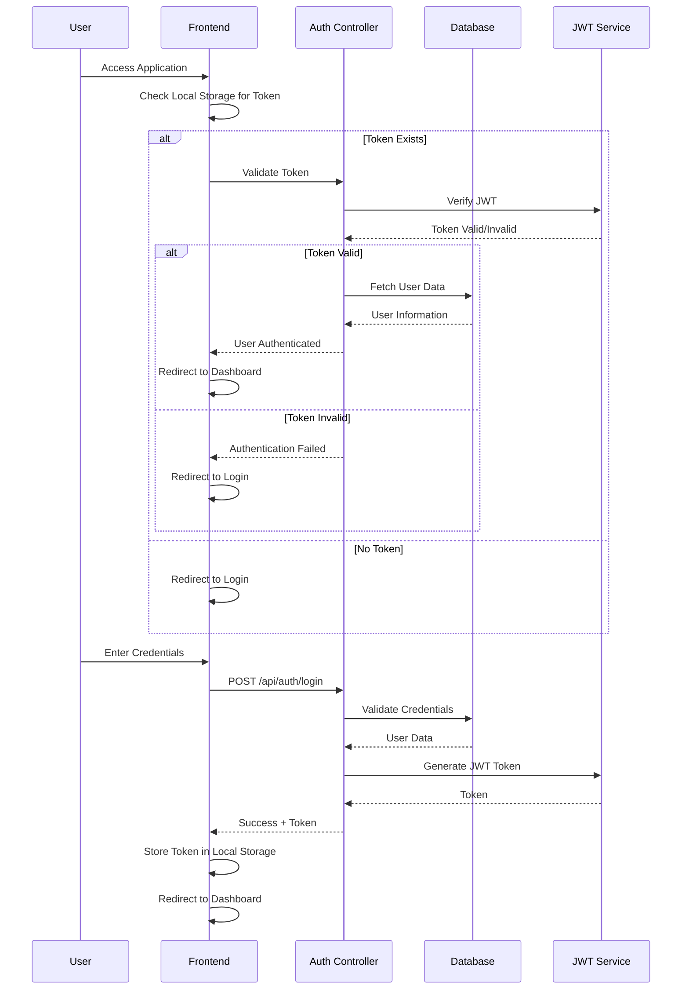

## Student Learning Flow

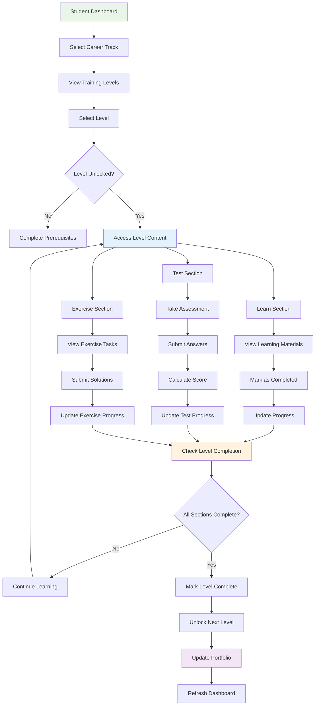

## Staff Management Flow

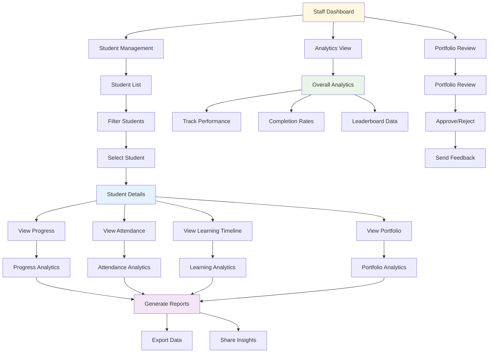

## Admin Management Flow

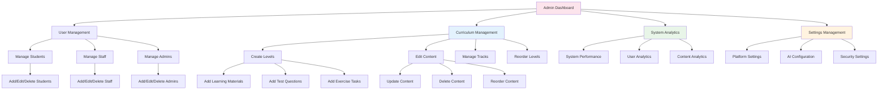

## Portfolio Generation Flow

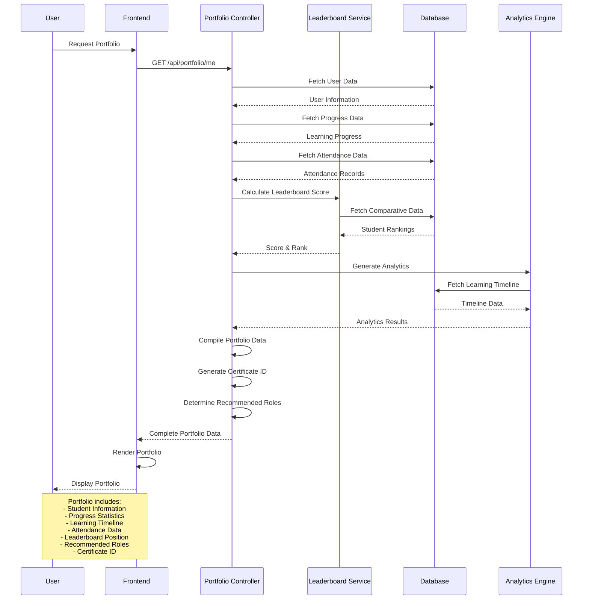

## API Request Flow

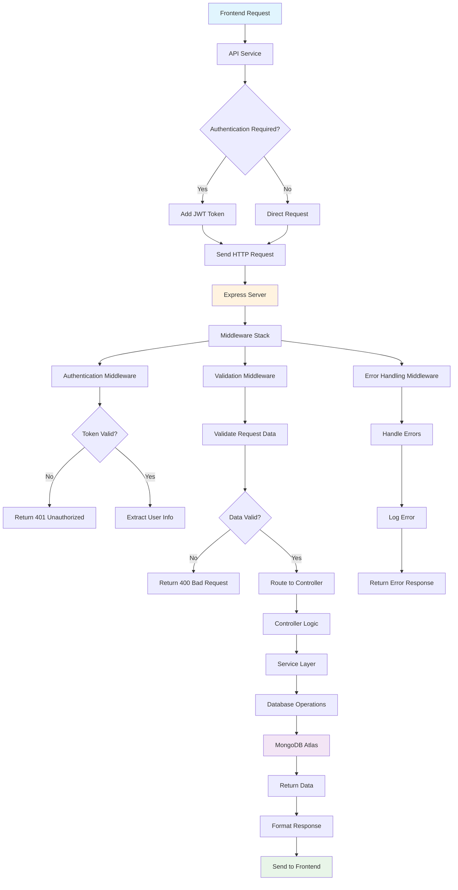

## Data Flow Architecture

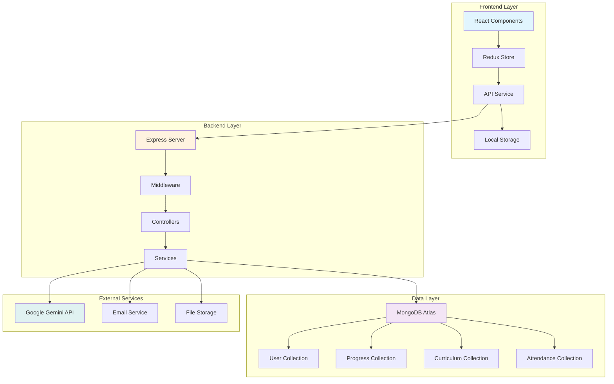

## Component Interaction Flow

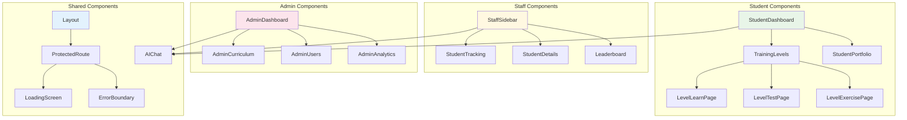

## Learning Progress Flow

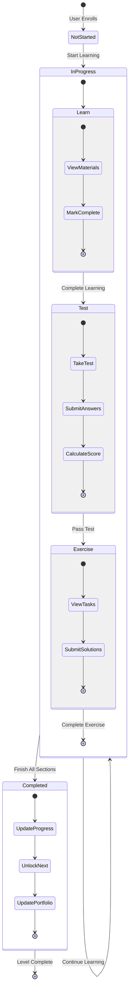

## System Integration Flow

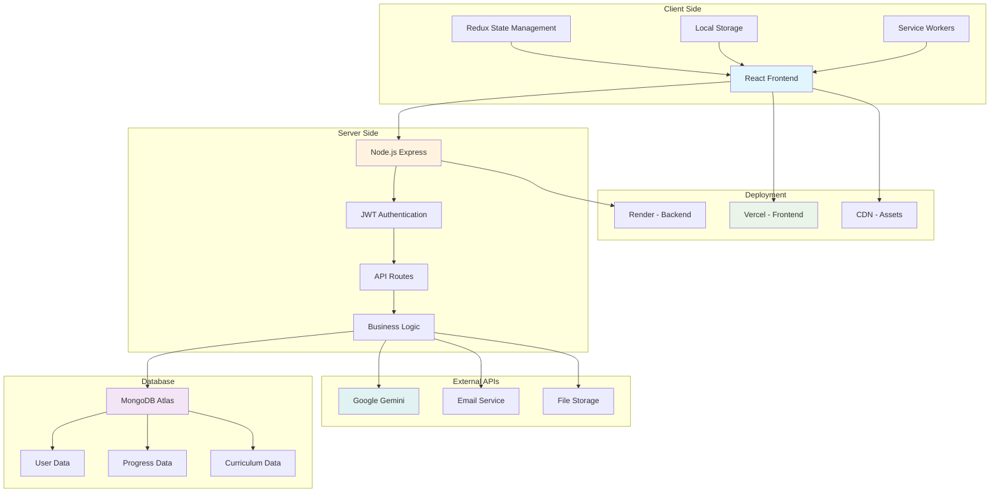

---

**Document Version**: v1.0  
**Last Updated**: January 2024  
**Next Review**: January 2025

## Key Flow Characteristics

### 1. **Authentication & Authorization**
- JWT-based stateless authentication
- Role-based access control (Student, Staff, Admin)
- Protected routes with middleware validation
- Session persistence with local storage

### 2. **Learning Progression**
- Sequential level unlocking system
- Three-section learning model (Learn, Test, Exercise)
- Real-time progress tracking
- Automated portfolio updates

### 3. **Data Management**
- Centralized Redux state management
- MongoDB document-based storage
- Real-time data synchronization
- Efficient caching strategies

### 4. **User Experience**
- Responsive design for all devices
- Progressive Web App capabilities
- Smooth animations and transitions
- Error handling and loading states

### 5. **System Integration**
- AI-powered chat assistance
- External API integrations
- Cloud-based deployment
- Scalable architecture design
