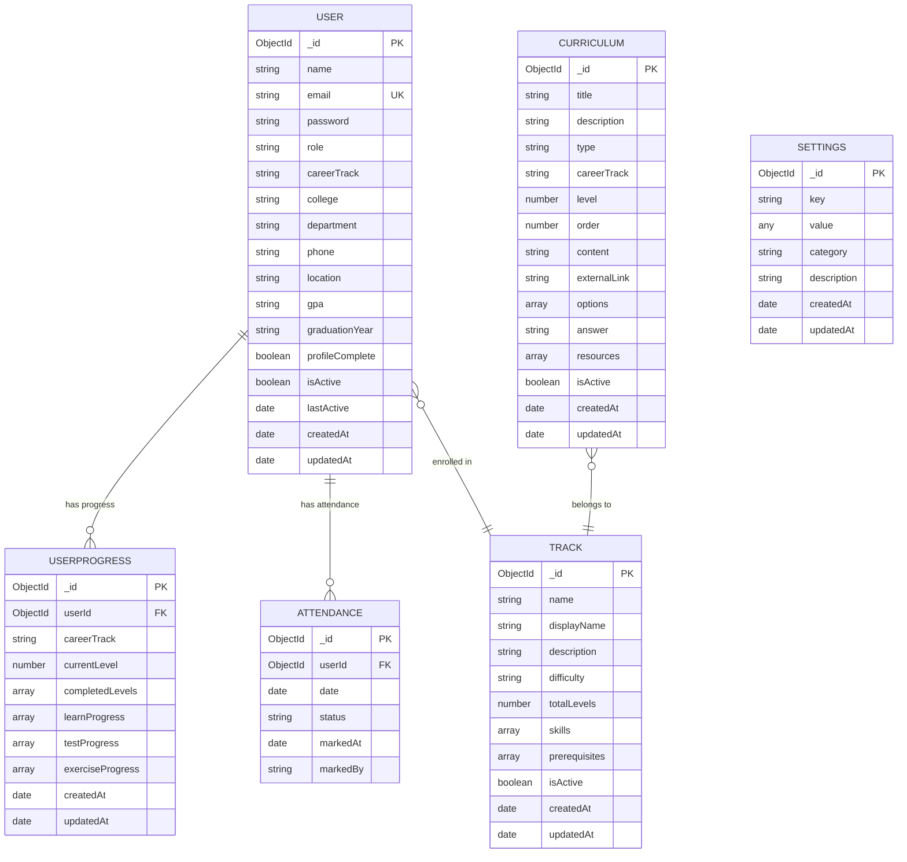
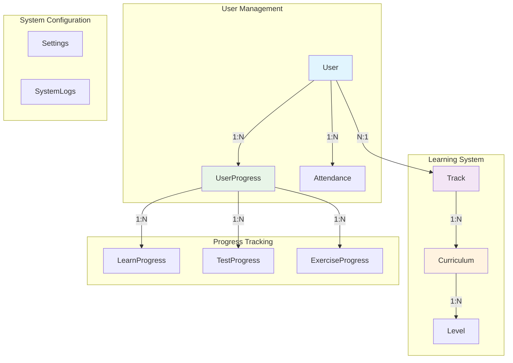
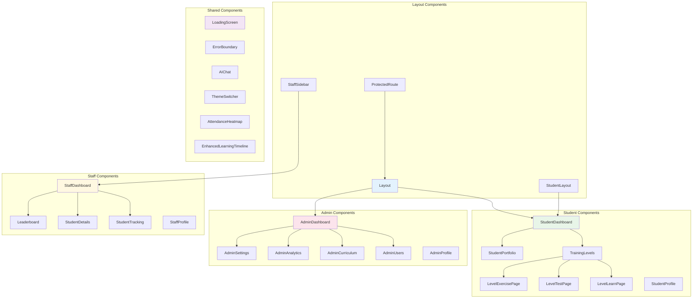
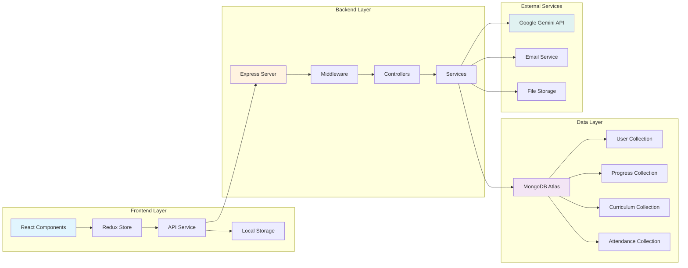
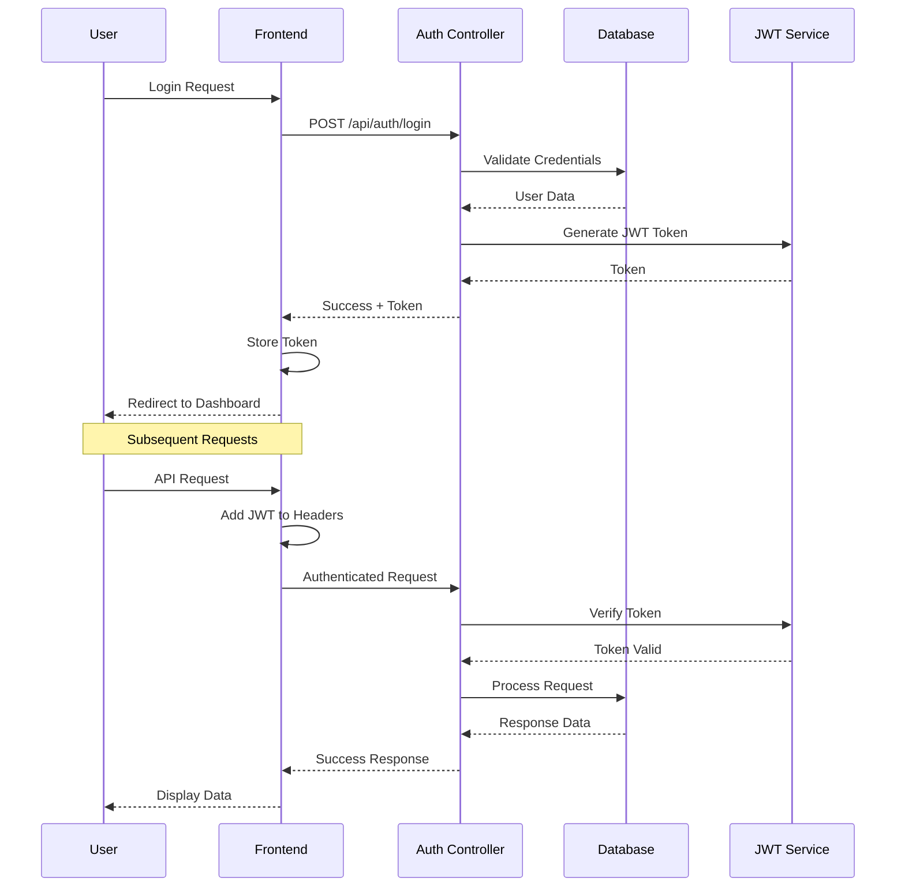
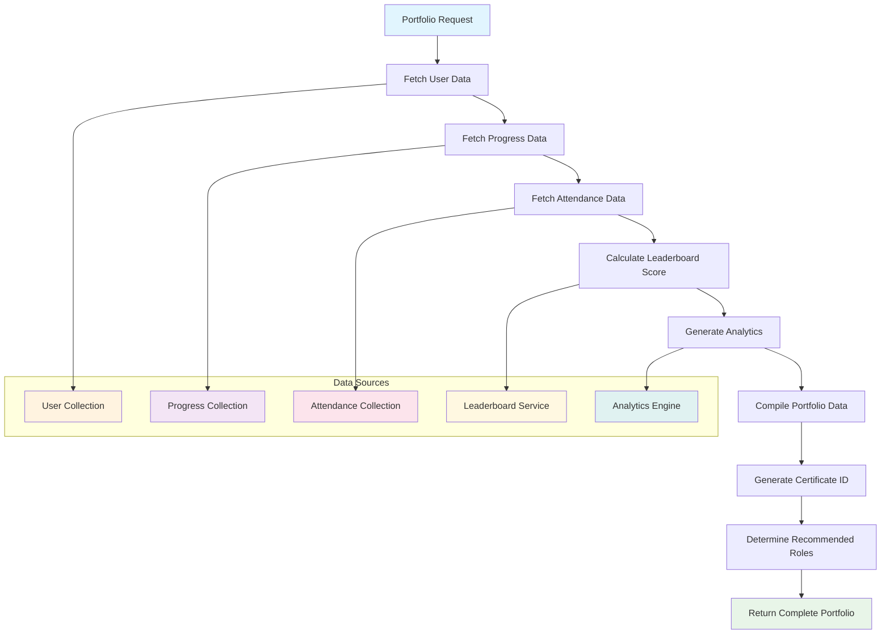
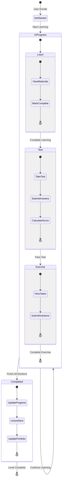
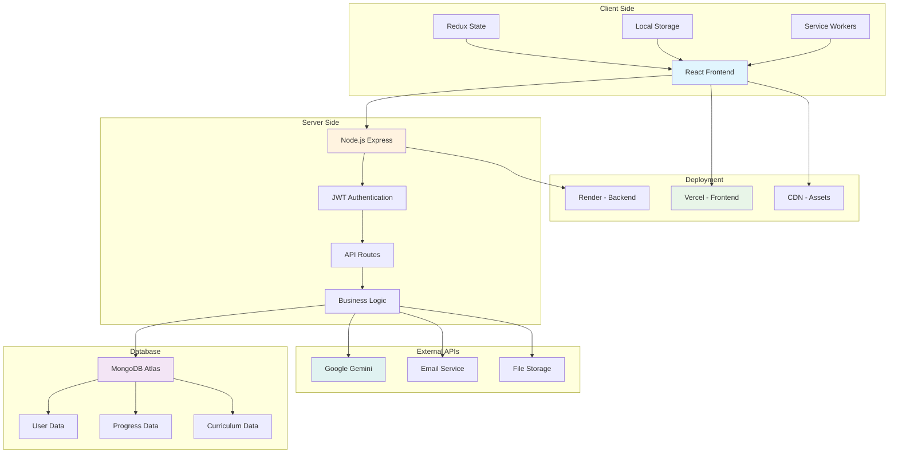

# Syncner Learning Management System - Schema Diagrams

## Document Information
- **Version**: 1.0
- **Date**: January 2024
- **Author**: Development Team
- **Status**: Production Ready

## Table of Contents
1. [Database Schema Diagram](#database-schema-diagram)
2. [Entity Relationship Diagram](#entity-relationship-diagram)
3. [API Schema Diagram](#api-schema-diagram)
4. [Component Schema Diagram](#component-schema-diagram)
5. [Data Flow Schema](#data-flow-schema)
6. [Authentication Schema](#authentication-schema)
7. [Portfolio Generation Schema](#portfolio-generation-schema)

## Database Schema Diagram

## Entity Relationship Diagram

## Complete API Schema Diagram

```mermaid
graph TD
    subgraph "🔐 Authentication APIs"
        A1[POST /api/auth/register]
        A2[POST /api/auth/login]
        A3[POST /api/auth/logout]
        A4[GET /api/auth/profile]
        A5[PUT /api/auth/profile]
        A6[POST /api/auth/forgot-password]
        A7[POST /api/auth/reset-password]
        A8[GET /api/auth/health]
    end
    
    subgraph "👤 User Management APIs"
        U1[GET /api/users/profile]
        U2[PUT /api/users/profile]
        U3[GET /api/users/]
        U4[GET /api/users/health]
    end
    
    subgraph "🎓 Student APIs"
        ST1[GET /api/student/portfolio/me]
        ST2[GET /api/student/portfolio/:studentId]
        ST3[GET /api/student/portfolio/public/:studentId]
    end
    
    subgraph "👨‍🏫 Staff APIs"
        S1[GET /api/staff/students]
        S2[GET /api/staff/students/:id]
        S3[GET /api/staff/analytics]
        S4[GET /api/staff/leaderboard]
        S5[GET /api/staff/leaderboard/:careerTrack]
        S6[GET /api/staff/test/:id]
    end
    
    subgraph "⚙️ Admin APIs"
        AD1[GET /api/admin/users]
        AD2[POST /api/admin/users]
        AD3[PUT /api/admin/users/:id]
        AD4[DELETE /api/admin/users/:id]
        AD5[POST /api/admin/users/:id/reset-password]
        AD6[GET /api/admin/analytics]
        AD7[GET /api/admin/level-progress]
        AD8[GET /api/admin/health]
        AD9[GET /api/admin/diagnostics]
        AD10[GET /api/admin/check-progress-orders]
        AD11[POST /api/admin/fix-progress-orders]
        AD12[POST /api/admin/cleanup-orphaned-progress]
    end
    
    subgraph "📚 Curriculum APIs"
        C1[GET /api/curriculum]
        C2[POST /api/curriculum]
        C3[GET /api/curriculum/:id]
        C4[PUT /api/curriculum/:id]
        C5[DELETE /api/curriculum/:id]
        C6[PATCH /api/curriculum/:id/toggle]
        C7[GET /api/curriculum/stats]
        C8[POST /api/curriculum/invalidate-cache]
        C9[PUT /api/curriculum/bulk-order]
        C10[DELETE /api/curriculum/level]
        C11[PUT /api/curriculum/level/reorder]
        C12[GET /api/curriculum/type/:type/track/:careerTrack]
        C13[GET /api/curriculum/content/:type]
        C14[GET /api/curriculum/content/:type/track/:careerTrack]
        C15[POST /api/curriculum/content]
        C16[PUT /api/curriculum/content/:id]
        C17[DELETE /api/curriculum/content/:id]
        C18[GET /api/curriculum/health]
    end
    
    subgraph "📊 Progress APIs"
        PR1[GET /api/progress/:careerTrack]
        PR2[GET /api/progress/levels-status]
        PR3[GET /api/progress/unlocked/:levelOrder]
        PR4[GET /api/progress/test-unlocked/:levelId]
        PR5[GET /api/progress/exercise-unlocked/:levelId]
        PR6[GET /api/progress/exercise-links/:levelId]
        PR7[GET /api/progress/level-sections/:levelId]
        PR8[POST /api/progress/complete]
        PR9[POST /api/progress/learn-progress]
        PR10[POST /api/progress/test-attempt]
        PR11[POST /api/progress/submit-exercise]
        PR12[PUT /api/progress/update-exercise]
    end
    
    subgraph "🏫 Training APIs"
        T1[GET /api/training/levels]
        T2[GET /api/training/levels/:id]
        T3[GET /api/training/health]
    end
    
    subgraph "📅 Attendance APIs"
        AT1[POST /api/attendance/mark]
        AT2[GET /api/attendance/:userId]
        AT3[GET /api/attendance/stats/:userId]
    end
    
    subgraph "🤖 AI APIs"
        AI1[POST /api/ai/chat]
        AI2[GET /api/ai/health]
    end
    
    subgraph "⚙️ Settings APIs"
        SET1[GET /api/admin/settings]
        SET2[PUT /api/admin/settings]
        SET3[GET /api/admin/settings/health]
    end
    
    subgraph "🎯 Track APIs"
        TR1[GET /api/tracks]
        TR2[GET /api/tracks/:id]
        TR3[GET /api/tracks/health]
    end
    
    subgraph "🏥 Health Check APIs"
        H1[GET /api/health]
        H2[GET /api/auth/health]
        H3[GET /api/users/health]
        H4[GET /api/tracks/health]
        H5[GET /api/training/health]
        H6[GET /api/admin/health]
        H7[GET /api/admin/settings/health]
        H8[GET /api/ai/health]
        H9[GET /api/curriculum/health]
    end
    
    subgraph "🌍 Public APIs"
        PUB1[GET /api/student/portfolio/public/:studentId]
    end
    
    subgraph "📁 File Upload APIs"
        F1[POST /api/upload]
    end
    
    style A1 fill:#e1f5fe
    style U1 fill:#e8f5e8
    style ST1 fill:#fff3e0
    style S1 fill:#f3e5f5
    style AD1 fill:#fce4ec
    style C1 fill:#fff8e1
    style PR1 fill:#e0f2f1
    style T1 fill:#f1f8e9
    style AT1 fill:#fce4ec
    style AI1 fill:#e8eaf6
    style SET1 fill:#fff3e0
    style TR1 fill:#e0f2f1
    style H1 fill:#f3e5f5
    style PUB1 fill:#e1f5fe
    style F1 fill:#fff8e1
```

## Component Schema Diagram

## Data Flow Schema

## Authentication Schema

## Portfolio Generation Schema

## Learning Progress Schema

## System Integration Schema

---

**Document Version**: v1.0  
**Last Updated**: January 2024  
**Next Review**: January 2025
